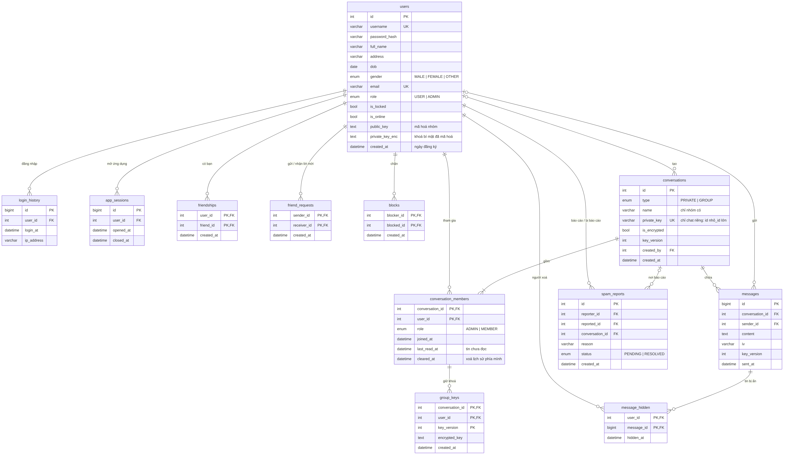

# Thiết kế cơ sở dữ liệu – Chat System

> **Bản nháp ERD** (T3 17/11). Chốt cùng `script/create_db.sql` trước 12:00 T4 18/11.
> Góp ý: comment vào Pull Request hoặc nhắn Nhân.

Phụ trách: Nguyễn Trần Trung Nhân (24127476)



- Ảnh: [`erd.png`](erd.png) (dán vào báo cáo), [`erd.svg`](erd.svg) (bản vector)
- Mã nguồn sơ đồ: [`erd.mmd`](erd.mmd) (Mermaid). Sửa file này rồi xuất lại ảnh bằng [mermaid.live](https://mermaid.live).
- Script tạo CSDL: [`script/create_db.sql`](../../script/create_db.sql), đã chạy thử trên MySQL 8.4.

Schema thiết kế cho cả **Phiên bản 2** (mã hoá nhóm, thống kê, xoá lịch sử phía mình), để sau này không phải sửa bảng.

## Danh sách bảng

| # | Bảng | Lưu gì | Dùng cho màn hình |
| --- | --- | --- | --- |
| 1 | `users` | Tài khoản (cả user và admin): tên đăng nhập, mật khẩu đã băm, họ tên, địa chỉ, ngày sinh, giới tính, email, vai trò, trạng thái khoá, online, ngày đăng ký, cặp khoá mã hoá | Đăng ký, đăng nhập, tài khoản, Quản lý user, DS đăng ký mới, biểu đồ đăng ký |
| 2 | `login_history` | Mỗi lần đăng nhập thành công | Lịch sử đăng nhập của 1 user, DS đăng nhập (admin) |
| 3 | `app_sessions` | Mỗi lần mở ứng dụng (mở, đóng) | DS user hoạt động, biểu đồ số người hoạt động |
| 4 | `friendships` | Quan hệ bạn bè, **mỗi quan hệ 2 dòng** (A,B) và (B,A) | DS bạn bè, bạn online, DS user + số bạn bè |
| 5 | `friend_requests` | Lời mời kết bạn đang chờ | DS lời mời kết bạn, Tìm người |
| 6 | `blocks` | Ai chặn ai | Nút Chặn, lọc tin nhắn / lời mời |
| 7 | `conversations` | Hội thoại: `PRIVATE` (2 người, có `private_key` để không tạo trùng) hoặc `GROUP` (tên, có mã hoá không, phiên bản khoá) | Khung chat, DS nhóm chat (admin) |
| 8 | `conversation_members` | Thành viên hội thoại, vai trò `ADMIN`/`MEMBER`, mốc đã đọc (đếm tin chưa đọc khi offline), mốc xoá lịch sử | Tạo / quản lý nhóm, DS thành viên, DS admin nhóm |
| 9 | `messages` | Tin nhắn (bản rõ, hoặc bản mã nếu nhóm mã hoá) | Khung chat, tìm trong cuộc chat, tìm toàn bộ tin nhắn |
| 10 | `message_hidden` | Tin nhắn mà 1 người đã xoá phía mình | Xoá 1 tin nhắn |
| 11 | `spam_reports` | Báo cáo spam: người báo cáo, người bị báo cáo, lý do, trạng thái | Báo cáo spam, DS báo cáo spam (admin) |
| 12 | `group_keys` | Khoá AES của nhóm, mã hoá riêng cho từng thành viên | Nhóm mã hoá đầu cuối |
| – | `v_user_friend_counts` (view) | Số bạn trực tiếp và số người gồm cả bạn của bạn | DS user + số bạn bè (admin) |

## Các quyết định thiết kế

- **Bạn bè lưu 2 chiều.** Kết bạn thì thêm 2 dòng, huỷ thì xoá 2 dòng (trong 1 transaction). Truy vấn "bạn của A" chỉ cần `WHERE user_id = A`, và đếm bạn của bạn bằng 1 phép JOIN.
- **Lời mời chỉ lưu khi đang chờ.** Đồng ý thì thêm vào `friendships` rồi xoá lời mời, từ chối thì xoá lời mời.
- **Chat riêng và chat nhóm dùng chung** `conversations` + `messages`, phân biệt bằng `type`. Khung chat chỉ cần 1 màn hình.
- **Mỗi 2 người chỉ có 1 cuộc chat riêng.** Chat riêng có `private_key = "<id nhỏ>_<id lớn>"` (vd user 7 và 3 -> `"3_7"`), cột này `UNIQUE` nên không thể tạo trùng, kể cả khi 2 người cùng bấm chat một lúc. Nhóm có `private_key = NULL` (MySQL cho phép nhiều NULL trong cột UNIQUE). Một `CHECK` đảm bảo chat riêng luôn có `private_key`, nhóm thì không. Tìm hoặc tạo chat riêng: `INSERT ... ON DUPLICATE KEY UPDATE` hoặc `SELECT ... WHERE private_key = '3_7'`.
- **Xoá tin phía mình không ảnh hưởng người khác:**
  - Xoá 1 tin: thêm 1 dòng `message_hidden`.
  - Xoá toàn bộ lịch sử: đặt `conversation_members.cleared_at = NOW(3)`, tin gửi trước mốc này bị ẩn với người đó. `cleared_at` là `DATETIME(3)` (mili giây) giống `messages.sent_at`, nên tin gửi ngay sau khi bấm xoá không bị ẩn nhầm.
- **Mã hoá nhóm (tham khảo Facebook).** Mỗi user có 1 cặp khoá RSA:
  - `public_key` để người khác mã hoá khoá nhóm gửi cho mình.
  - `private_key_enc` là khoá bí mật đã mã hoá bằng mật khẩu, nhờ vậy đăng nhập ở máy khác vẫn đọc được tin. Server không bao giờ thấy khoá bí mật gốc.

  Nhóm có 1 khoá AES, mã hoá riêng bằng public key của từng thành viên và lưu vào `group_keys`. Tin nhắn lưu bản mã kèm `iv` và `key_version`. Thêm hoặc xoá thành viên thì tăng `conversations.key_version` và tạo khoá mới, nên người đã rời nhóm không đọc được tin mới. Thành viên bị xoá khỏi nhóm thì khoá của người đó tự xoá theo (khoá ngoại tới `conversation_members`).
  - Đổi mật khẩu: giải mã `private_key_enc` bằng mật khẩu cũ rồi mã hoá lại bằng mật khẩu mới.
  - Quên mật khẩu (mật khẩu random gửi email): không giải mã được khoá cũ, nên tạo cặp khoá mới. Tin mã hoá cũ không đọc lại được, giống Facebook khi quên mã PIN.
- **Tìm kiếm chuỗi dùng `LIKE '%chuỗi%'`, không dùng FULLTEXT.** Đề yêu cầu tìm chuỗi con, nhưng FULLTEXT chỉ khớp nguyên từ từ 3 ký tự trở lên (đã thử: tìm "ok", "Jav", "đồ án" bằng FULLTEXT đều ra 0 dòng). Nhờ collation `ai_ci`, tìm "hop nhom" vẫn ra "Họp nhóm". Chỉ quét các cuộc chat của mình (index `conversation_id, sent_at`). Tin mã hoá thì giải mã ở máy người dùng rồi mới tìm.
- **Xoá user (admin).** Dữ liệu riêng của user xoá theo (CASCADE). Tin nhắn trong nhóm vẫn giữ lại, chỉ có `sender_id` thành `NULL` (hiển thị "Người dùng đã bị xoá").
- **Ràng buộc kiểm tra ở tầng Java:** không tự kết bạn, chặn hay báo cáo chính mình; chat riêng đúng 2 thành viên; nhóm có ít nhất 1 admin. Lý do: MySQL không cho `CHECK` trên cột khoá ngoại có `ON DELETE CASCADE / SET NULL`.
- **Giá trị ENUM viết tiếng Anh, viết hoa** (`MALE`, `PENDING`...). Giao diện đổi sang tiếng Việt khi hiển thị.
- **Collation `utf8mb4_0900_ai_ci`:** tìm "nhan" ra được "Nhân", không phân biệt hoa thường.

## Truy vấn mẫu cho các màn thống kê (đã chạy thử)

```sql
-- Số người đăng ký mới theo tháng trong năm
SELECT MONTH(created_at) AS thang, COUNT(*) AS so_luong
FROM users WHERE YEAR(created_at) = 2026 GROUP BY thang;

-- Số người hoạt động (có mở ứng dụng) theo tháng trong năm
SELECT MONTH(opened_at) AS thang, COUNT(DISTINCT user_id) AS so_luong
FROM app_sessions WHERE YEAR(opened_at) = 2026 GROUP BY thang;

-- DS user hoạt động trong khoảng thời gian: số lần mở app, số người đã chat, số nhóm đã chat
SELECT u.username,
  (SELECT COUNT(*) FROM app_sessions s
     WHERE s.user_id = u.id AND s.opened_at BETWEEN :tu AND :den) AS so_lan_mo_app,
  (SELECT COUNT(DISTINCT m.conversation_id) FROM messages m JOIN conversations c ON c.id = m.conversation_id
     WHERE m.sender_id = u.id AND c.type = 'PRIVATE' AND m.sent_at BETWEEN :tu AND :den) AS so_nguoi_da_chat,
  (SELECT COUNT(DISTINCT m.conversation_id) FROM messages m JOIN conversations c ON c.id = m.conversation_id
     WHERE m.sender_id = u.id AND c.type = 'GROUP' AND m.sent_at BETWEEN :tu AND :den) AS so_nhom_da_chat
FROM users u;

-- Tìm hoặc tạo chat riêng giữa :a và :b (id nhỏ đứng trước)
SELECT id FROM conversations WHERE private_key = CONCAT(LEAST(:a, :b), '_', GREATEST(:a, :b));

-- Tin nhắn user :me nhìn thấy trong 1 cuộc chat (đã trừ tin bị xoá phía mình)
SELECT m.* FROM messages m
JOIN conversation_members cm ON cm.conversation_id = m.conversation_id AND cm.user_id = :me
WHERE m.conversation_id = :conv
  AND (cm.cleared_at IS NULL OR m.sent_at > cm.cleared_at)
  AND NOT EXISTS (SELECT 1 FROM message_hidden h WHERE h.user_id = :me AND h.message_id = m.id)
ORDER BY m.sent_at;

-- Tìm chuỗi trong toàn bộ tin nhắn của :me (bấm kết quả -> mở cuộc chat conversation_id, cuộn tới id)
SELECT m.id, m.conversation_id, m.sender_id, m.content, m.sent_at
FROM messages m
JOIN conversation_members cm ON cm.conversation_id = m.conversation_id AND cm.user_id = :me
JOIN conversations c ON c.id = m.conversation_id AND c.is_encrypted = FALSE
WHERE m.content LIKE CONCAT('%', :chuoi, '%')
  AND (cm.cleared_at IS NULL OR m.sent_at > cm.cleared_at)
  AND NOT EXISTS (SELECT 1 FROM message_hidden h WHERE h.user_id = :me AND h.message_id = m.id)
ORDER BY m.sent_at DESC;

-- DS user + số bạn bè
SELECT * FROM v_user_friend_counts WHERE direct_friends > 3;
```

## Đối chiếu với đề bài

Mỗi chức năng trong đề bài lấy dữ liệu từ bảng nào. "Java" nghĩa là CSDL không cần lưu thêm gì, phần xử lý nằm ở code.

**Phân hệ quản trị**

| Yêu cầu | Bảng / cột |
| --- | --- |
| Quản lý user: tên đăng nhập, họ tên, địa chỉ, ngày sinh, giới tính, email | `users` |
| Lọc theo tên / tên đăng nhập / trạng thái, sắp xếp theo tên / ngày tạo | `users.full_name`, `username`, `is_locked` (hoặc `is_online`), `created_at` |
| Thêm / cập nhật / xoá, khoá / mở khoá, cập nhật mật khẩu | `users` (xoá thì CASCADE), `is_locked`, `password_hash` |
| Xem lịch sử đăng nhập, danh sách bạn bè của 1 user | `login_history`, `friendships` |
| DS đăng nhập theo thời gian (thời gian, tên đăng nhập, họ tên) | `login_history` JOIN `users` |
| DS nhóm chat: sắp xếp tên / thời gian tạo, lọc tên, xem thành viên, xem admin | `conversations` (`type = 'GROUP'`), `conversation_members.role` |
| DS báo cáo spam: sắp xếp / lọc theo thời gian, tên đăng nhập; khoá tài khoản | `spam_reports` JOIN `users`, `users.is_locked` |
| DS đăng ký mới trong khoảng thời gian + biểu đồ theo tháng | `users.created_at` |
| DS user + số bạn trực tiếp + gồm bạn của bạn, lọc =, <, > | view `v_user_friend_counts` |
| DS user hoạt động: số lần mở app, số người đã chat, số nhóm đã chat | `app_sessions`, `messages` JOIN `conversations.type` |
| Biểu đồ số người hoạt động (có mở ứng dụng) theo tháng | `app_sessions.opened_at` |

**Phân hệ người dùng**

| Yêu cầu | Bảng / cột |
| --- | --- |
| Đăng ký, cập nhật thông tin, đổi mật khẩu, đăng nhập | `users`, `login_history`, `app_sessions` |
| Khởi tạo lại mật khẩu (random, gửi email) | `users.email`, `password_hash` + Java gửi mail |
| DS bạn bè, lọc tên, online / offline | `friendships` JOIN `users.is_online` |
| Tìm theo tên và gửi lời mời; huỷ kết bạn | `users`, `friend_requests`, `friendships` |
| Block và huỷ kết bạn, người bị block không gửi lại lời mời được | `blocks` (Java kiểm tra trước khi tạo `friend_requests`) |
| DS lời mời kết bạn, lọc tên, đồng ý / từ chối | `friend_requests` |
| DS bạn đang online: chat, tạo group | `friendships` + `users.is_online` |
| Tìm người theo tên đăng nhập / tên, không thấy người đã block mình | `users` trừ `blocks.blocker_id` |
| Báo cáo spam khi người đó chat với mình | `spam_reports` (có `conversation_id`) |
| Chat thời gian thực khi online | Java (socket); tin vẫn lưu vào `messages` |
| Gửi tin khi bạn offline để xem sau | `messages` + `conversation_members.last_read_at` (đếm tin chưa đọc) |
| Xem lịch sử chat | `messages` (`conversation_id`, `sent_at`) |
| Xoá toàn bộ lịch sử chat (phía mình) | `conversation_members.cleared_at` (`DATETIME(3)`) |
| Xoá 1 hoặc vài dòng (phía mình) | `message_hidden` |
| Tìm chuỗi trong 1 cuộc chat / tất cả cuộc chat, nhảy tới đoạn đó | `messages.content LIKE`, kết quả có `conversation_id` + `id` |
| Gọi LLM gợi ý / chỉnh tin nhắn | Java (gọi API), không lưu CSDL |
| Tạo nhóm (thêm ít nhất 1 tên đăng nhập), đổi tên, thêm thành viên | `conversations`, `conversation_members` |
| Gán admin nhóm; chỉ admin được xoá thành viên | `conversation_members.role` (Java kiểm tra quyền) |
| Mã hoá nhóm (tham khảo Facebook) | `conversations.is_encrypted`, `key_version`, `group_keys`, `users.public_key`, `private_key_enc`, `messages.iv` |
